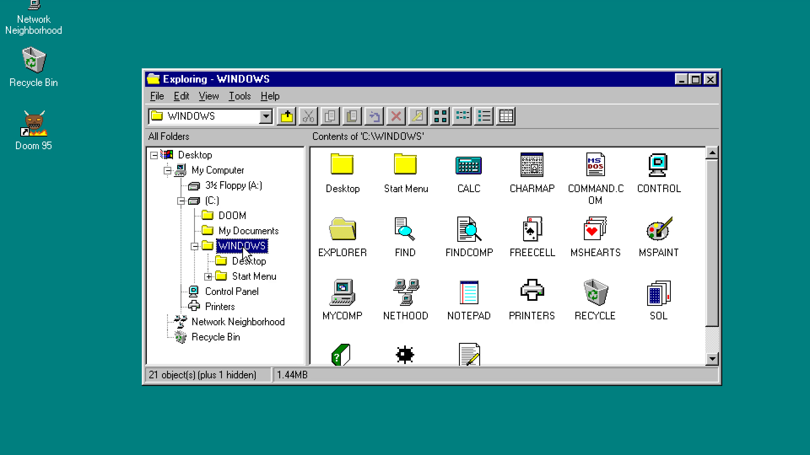
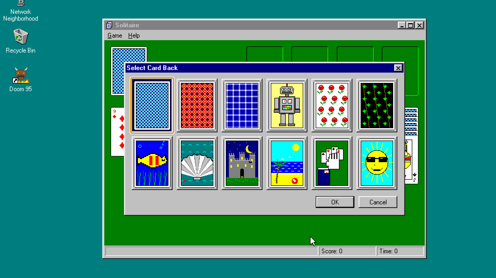
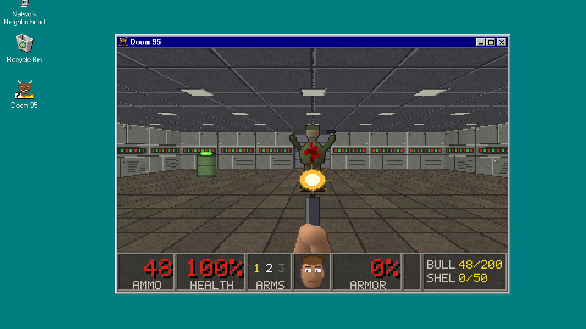
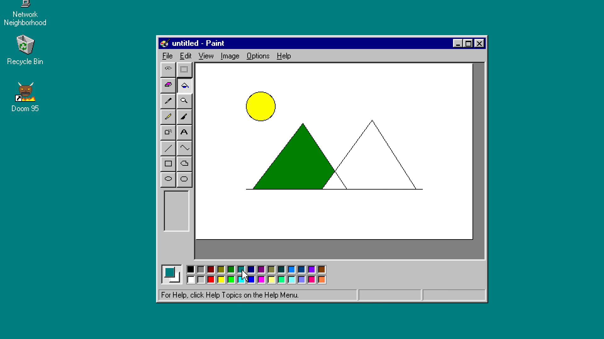
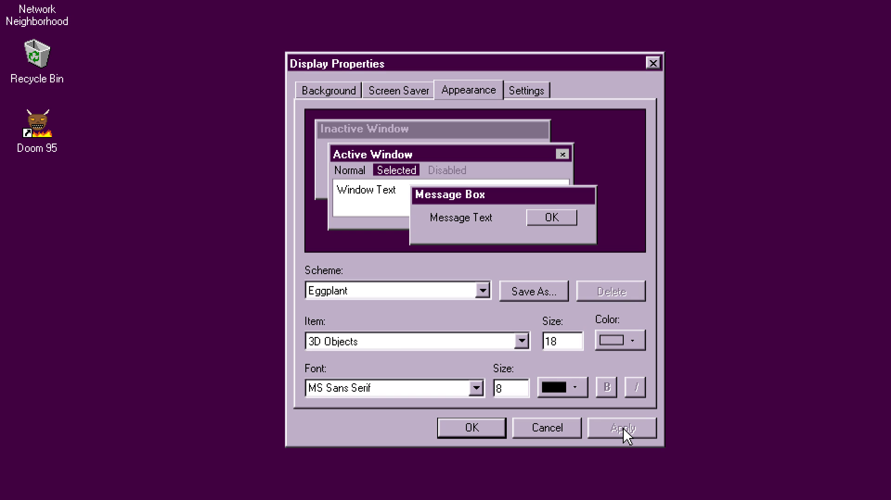

# Windows 95

A Windows 95 recreation built with React, TypeScript, and Electron. The same renderer also runs in a web browser. Open the Start menu, write a document, draw in Paint, play a game, or change the desktop's appearance.

[Live demo](https://win95.juguilon.com/)



## Explore the desktop

The shell has a taskbar, movable and resizable windows, keyboard menus, desktop shortcuts, file dialogs, and a persistent virtual C: drive.

| Area | What's included |
| --- | --- |
| Files and folders | Windows Explorer, My Computer, Recycle Bin, Find Files, and shortcuts with editable properties. |
| Documents and drawing | Notepad, WordPad with rich text and pictures, Paint, Calculator, and Character Map. |
| Games | Minesweeper, Solitaire with card backs and the win animation, numbered FreeCell deals, Hearts against computer players, and Doom 95. |
| Customization | Control Panel with appearance schemes, backgrounds, screen savers, fonts, mouse and keyboard settings, sounds, and a virtual clock. |
| Help and commands | Windows Help with app topics and an MS-DOS Prompt that works with the virtual drive. |

## Screenshots

| Solitaire card backs | Doom 95 |
| --- | --- |
|  |  |
| Paint | Display Properties |
|  |  |

These are real captures of the production Electron app. Open an image to see it at full size.

## Run locally

Use Windows x64 for desktop development and packaging. Install Node.js 22.12 or later and pnpm. The browser renderer uses the same source without the Electron host.

For an offline install, the pnpm store must contain the packages in `pnpm-lock.yaml`, and the Electron download cache must contain Electron 45.0.0. An empty cache cannot support an offline install.

```powershell
pnpm install --offline --frozen-lockfile
```

The install, development, and build scripts import fonts, cursors, and sounds from the builder's installed Windows. `W95_SYSTEM_ROOT` overrides the source directory. Missing assets fall back to the bundled font, CSS cursors, and silence. See the [system asset documentation](src/renderer/src/system/README.md) for sources and handling.

### Start the desktop

```powershell
pnpm dev
```

After boot, open **Start > Programs** to choose an app. **Start > Run** accepts names such as `notepad`, `mspaint`, `sol`, and `doom95`.

### Start the browser renderer

```powershell
pnpm dev:web --port 5401
```

Open `http://localhost:5401`. Choose another port if 5401 is occupied. Without a port override, the web configuration uses port 5395.

### Build and package

| Command | Result |
| --- | --- |
| `pnpm build` | Electron main, preload, and renderer builds in `out/`. |
| `pnpm start` | Preview the existing Electron build. Run `pnpm build` first. |
| `pnpm build:web` | Static browser build in `dist/web/`. Serve this directory with a static web server. |
| `pnpm package` | Build and package the Windows x64 desktop app and ZIP in `release/`. |

Close any running copy of the previous package before packaging. The outputs are `release/Windows 95-win32-x64/Windows 95.exe` and `release/Windows 95-win32-x64.zip`. Keep the executable with its entire folder. The packaged app needs neither this checkout nor `node_modules` at runtime.

## Controls

- Double-click desktop icons to open them. Right-click the desktop or a file for its menu.
- Drag a title bar to move a window. Drag an edge or corner to resize it. Taskbar buttons restore minimized windows.
- Press Ctrl+Esc to toggle Start, Escape to dismiss a menu or dialog, and Alt+F4 to close the active window.
- Press F2 to rename a selected file. Delete asks before moving it to the Recycle Bin.
- Press F11 to toggle Electron full screen. In the browser, click the safe-to-turn-off screen to boot again.

Windows-key shortcuts work when the app receives them, including Windows+R for Run and Windows+E for Explorer. The host OS can consume these keys even in full screen. Ctrl+Esc and the Start button remain available.

## Saved data

Documents, pictures, settings, and game records stay in browser storage, separate from the host's files. Electron keeps that storage in its user-data profile. A web browser keeps it for the current origin. Clearing that storage removes the saved desktop data.

Development, production, and different web ports have separate storage origins. Changing the launch mode or URL can therefore show a different virtual drive. Use `W95_DATA_DIR` to select a separate Electron profile, as described in the [developer guide](docs/development.md#storage-and-profiles).

## Develop

The [developer guide](docs/development.md) covers the source layout, app manifests, virtual file system, shared UI, build checks, and live Electron checks.

See [Deploy to Cloudflare Pages](docs/deployment.md) for the public web build and upload commands.

## Scope and credits

This is an independent recreation of the Windows 95 experience. It does not install Windows or run arbitrary Windows binaries. Network Neighborhood, printer setup, and hardware dialogs recreate the UI without configuring host devices or networking. WordPad reads RTF and text, and writes RTF for its rich document formats, including `.doc`. It does not implement the original binary Word or Write formats.

The MS-DOS Prompt implements commands such as `DIR`, `CD`, `COPY`, `TYPE`, and `ECHO` against the virtual drive. It is not a host command shell or a DOS emulator. Doom 95 is a custom TypeScript raycasting game with three built-in levels, generated graphics, and synthesized sound. It does not run the original Doom executable or load WAD files.

Created by Prince Carlo Juguilon. The desktop and applications draw on Microsoft Windows 95, and Doom draws on id Software's game. Imported Windows fonts, cursors, and sounds come from the builder's own installation, are ignored by Git, and are not project-authored assets. The [system asset documentation](src/renderer/src/system/README.md) says not to distribute those generated Microsoft assets.

The [package metadata](package.json) declares `ISC`, but this repository does not include a `LICENSE` file.
